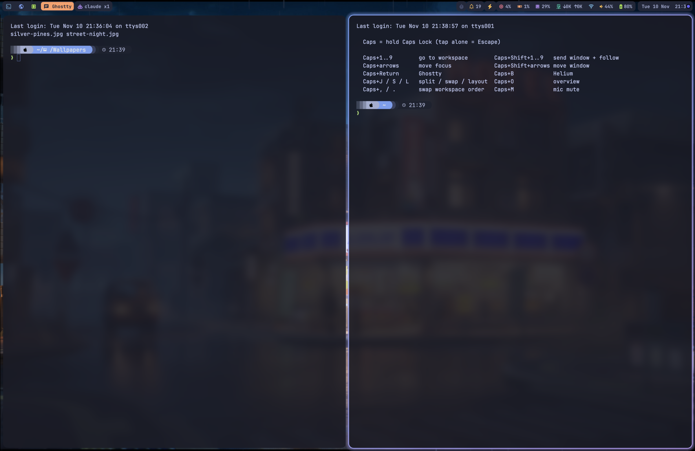
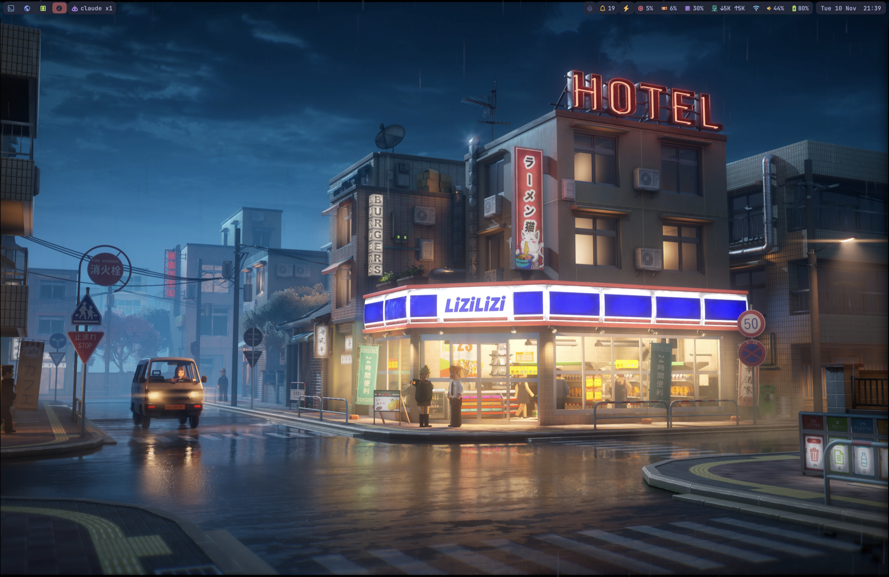

# macOS tiling desktop

An Omarchy/Hyprland-style desktop on a MacBook: dwindle tiling, a keyboard-first workflow on Caps Lock, a transparent Tokyo Night status bar, and a matching terminal.





Built and tested on an Apple Silicon MacBook Pro running macOS 26 (Tahoe), with a Turkish keyboard layout. Nothing here needs SIP turned off.

## What's in it

| Folder | Tool | What it does |
|---|---|---|
| `omniwm/` | [OmniWM](https://omniwm.app) | Window manager. Dwindle (Hyprland-style) tiling, nine workspaces, focus border with a blue-to-purple gradient. Its own bar is off. |
| `sketchybar/` | [SketchyBar](https://github.com/FelixKratz/SketchyBar) | The status bar, see below. |
| `karabiner/` | [Karabiner-Elements](https://karabiner-elements.pqrs.org) | Caps Lock becomes Hyper (hold) or Escape (tap), plus app launchers and a few shell shortcuts. |
| `ghostty/` | [Ghostty](https://ghostty.org) | Tokyo Night, translucent, JetBrainsMono Nerd Font. |
| `starship/` | [Starship](https://starship.rs) | The `tokyo-night` preset. |
| `bin/wallpaper` | | `wallpaper street`, `wallpaper next` or any image path. Wallpapers are not included. |

### The bar

Transparent, with rounded item groups. From left to right:

- **Workspaces** with per-workspace icon colours; the focused one shows the app name. Empty ones are hidden.
- **Now playing** (system-wide, via `nowplaying-cli`). Scrolls only on hover. Click to play or pause.
- **Notifications** read from Notification Center through the accessibility API, shown inline in the bar. The system banner is moved off-screen. Clicking the bell lists recent ones.
- **Clipboard notices** (`Copied: …`), **downloads**, **AI agent activity** (Claude Code and Codex sessions), **timer and stopwatch** (`bar-timer 25m`).
- **Right side:** mic-muted icon (only while muted), CPU, GPU, RAM, network speed, Wi-Fi and battery popups, volume mixer popup, clock.

Workspaces close up automatically: close the last window on workspace 3 and workspace 4 becomes 3. `ws-swap` reorders them.

## Shortcuts

`Caps` means hold Caps Lock.

| Keys | Action |
|---|---|
| Caps + 1…9 | Go to workspace |
| Caps + Shift + 1…9 | Send the window to a workspace and follow it |
| Caps + arrows / Caps + Shift + arrows | Move focus / move window |
| Caps + J, S, L | Flip split, swap halves, switch dwindle ⇄ scrolling layout |
| Caps + W, F, T | Close, fullscreen, float |
| Caps + O, Space, \` | Overview, command palette, drop-down terminal |
| Caps + Return, B, E | Ghostty, Helium (browser), Finder |
| Caps + M | Toggle microphone mute |
| Caps + , and . | Swap the workspace with the previous / next one |

The app launchers are examples: edit the "Hyper app launchers" rule in `karabiner/karabiner.json` to open your own apps.

## Install

```sh
git clone https://github.com/omerdikyol/macos-tiling-dotfiles
cd macos-tiling-dotfiles
less install.sh   # it overwrites existing configs (it keeps *.pre-dotfiles copies)
./install.sh
```

The install script has not been run end to end on a clean machine. It installs the tools with Homebrew, copies the configs into place and compiles two small Swift helpers.

Things macOS makes you do by hand:

1. **Privacy & Security:** allow Accessibility and Input Monitoring for OmniWM, Karabiner-Elements and `/opt/homebrew/bin/sketchybar` (SketchyBar needs Accessibility for the notification reader; the ⚡ button is an optional launcher for the author's own Vorssaint app, delete it from `sketchybarrc` if you do not use it).
2. **System Settings → Keyboard → Keyboard Shortcuts → Modifier Keys:** set Caps Lock to **No Action**. Without it, macOS toggles Caps Lock on long presses even though Karabiner remaps the key.
3. Start OmniWM, and reload Ghostty with Cmd+Shift+,.

## Things to know

- **Keyboard layout.** Karabiner names keys by their US position. The workspace-swap keys are bound for a Turkish layout (`non_us_pound` and `slash`); on a US keyboard change them to `comma` and `period`. Option stays free on purpose, so symbols like `@` still type on layouts that use Option for them.
- **OmniWM's `settings.toml` is strict.** One bad value makes it set the whole file aside as `settings.toml.corrupt`. Copy the file before editing, or use its Settings app.
- **Hidden SketchyBar items don't update** unless they have `updates=on`. Every item here that hides itself sets it.
- **No real Caps Lock.** This setup gives that key to the shortcuts. Karabiner could not reliably toggle it back on this machine, so there is no Caps Lock mode.
- **Paths.** `karabiner/karabiner.json` uses `__HOME__` placeholders, which the install script replaces. `ws-swap` and `mic-toggle` assume Homebrew at `/opt/homebrew`.
- **Notification reader limits.** It only sees banners that actually appeared, so notifications silenced by a Focus mode never reach the bar.
- The `omniwm/settings.toml` here includes the author's workspace and rule IDs. They are not secrets, but OmniWM regenerates its own on first run if you start fresh.

## Credits and licence

- The bar's look is adapted from [Pe8er/dotfiles](https://github.com/Pe8er/dotfiles) (MIT).
- Wallpapers used in the screenshot are from Wallhaven (`lygo7y` and `w53jlr`). They belong to their artists and are not in this repo.
- Everything else is MIT, see [LICENSE](LICENSE).
